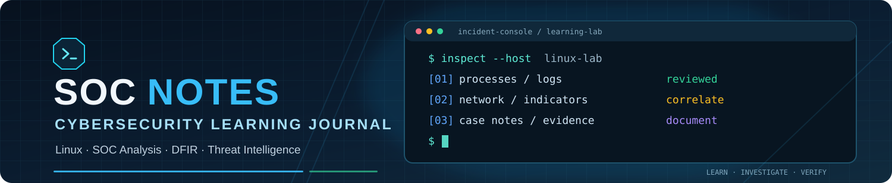

<div align="center">



[](daily-log.md)
[](daily-log.md)
[](daily-log.md)

**Learn · Investigate · Document · Verify · Improve**

*A practical record of my journey toward SOC analysis, cyber threat intelligence, and digital forensics and incident response.*

</div>

---

## 🧭 Learning journey

| Day | Focus | Status / record |
|:---:|---|---|
| [00](day0-setup.md) | 🧰 Lab setup and connectivity | Documented |
| [01](day1-linux-log-analysis.md) | 🐧 Linux fundamentals and authentication-log analysis | Practised |
| [02](day2-process-networking.md) | 🔎 Processes and networking | Practised |
| [03](day3-notes.md) | 📝 Daily activity record | Needs verification |
| [04](day4-linux-triage.md) | 🧪 Linux security triage project | Historical progress; verify current state |
| [05](day5-report-validation.md) | ✅ Report and error-handling tests | Partial validation recorded |
| [06](day6-soc-cti.md) | 🚨 SOC response and threat intelligence | Case exercises documented |

➡️ **[Open the full learning log](daily-log.md)**

## ⭐ Featured work

<table>
<tr>
<td width="50%" valign="top">

### 🐧 Authentication-log analyser

A small Bash script that counts failed SSH login attempts by source IP from sample log data.

- [Script: `auth-summary.sh`](auth-summary.sh)
- [Sample authentication log](auth.log)
- [Test cases](test-auth.log)
- [Day 1 notes](day1-linux-log-analysis.md)

**Practised:** pipes, text processing, file handling, test inputs, and basic log triage.

</td>
<td width="50%" valign="top">

### 🚨 SOC and CTI case exercises

Documented simulated investigations involving suspicious endpoint execution, a fictional domain, and interpretation of historical threat intelligence.

- [Day 6 case notes](day6-soc-cti.md)
- [Public CISA historical report](https://www.cisa.gov/news-events/analysis-reports/ar21-112a)

**Focus:** evidence-based conclusions, correlation, containment considerations, and explicit uncertainty.

</td>
</tr>
</table>

## 🧰 Skills in practice

| Area | Recorded practice |
|---|---|
| **Linux** | Navigation, files, permissions, pipes, and command-line basics |
| **Log analysis** | `grep`, `awk`, `sort`, `uniq`; failed-login counting |
| **Process triage** | `ps`, `pgrep`, PIDs, PPIDs, CPU and memory context |
| **Network triage** | `ip addr`, `ip route`, `ss`, `ping`, `getent`, `curl` |
| **Bash** | Small log-summary script and test data |
| **SOC investigation** | Incident assessment, evidence preservation, containment considerations |
| **CTI** | Indicator context, confidence, correlation, and attribution limits |

## 🗺️ Current roadmap

- [x] Set up the repository and begin documenting Linux practice
- [x] Build and test the authentication-log summary script
- [x] Practise initial process and network inspection
- [x] Document simulated SOC and CTI case exercises
- [ ] Verify the original Day 3 activity record
- [ ] Recheck and integrate the separate Linux triage project
- [ ] Continue Bandit from a verified active checkpoint

## 📁 Repository map

```text
soc-notes/
├── README.md                     # Portfolio landing page
├── daily-log.md                  # Day-by-day overview
├── day0-setup.md                 # Lab setup and connectivity check
├── day1-linux-log-analysis.md   # Formatted Day 1 Linux and log-analysis notes
├── day1-notes.txt                # Original plain-text note
├── day2-process-networking.md    # Process and networking practice
├── day3-notes.md                 # Day 3 record pending verification
├── day4-linux-triage.md          # Linux triage project notes
├── day5-report-validation.md     # Report validation notes
├── day6-soc-cti.md               # SOC incident response and CTI cases
├── auth-summary.sh               # Failed-login summary script
├── auth.log                      # Sample authentication events
├── test-auth.log                 # Script test data
└── notes.txt                     # Initial Linux note
```

## 🔐 Responsible practice and accuracy

All work is for learning in controlled or authorised environments. Day 6 scenarios and related training logs are simulations. Historical indicators are described in their original context and are not treated as proof of current malicious activity. Where the record is incomplete or work is unfinished, that limitation is stated rather than filled with assumptions.

> **Portfolio standard:** show the evidence, explain the result, state what remains unknown.

<div align="center">
<sub>Updated as practice is completed and verified.</sub>
</div>
